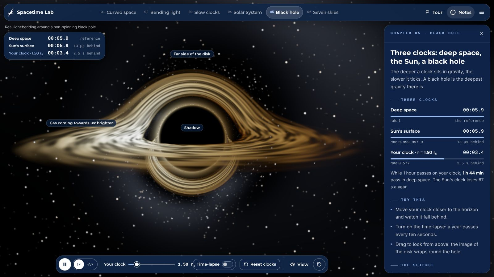
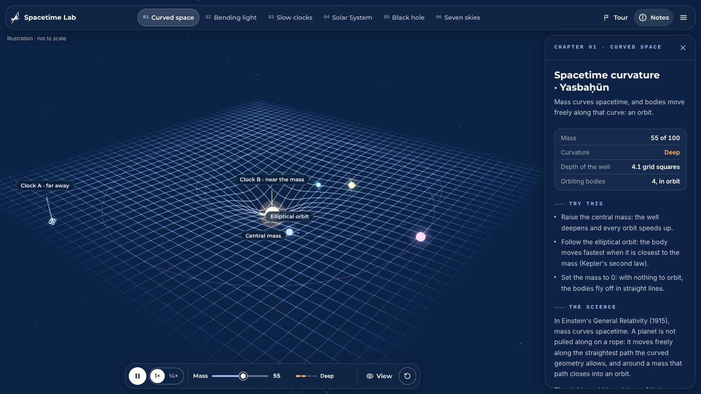
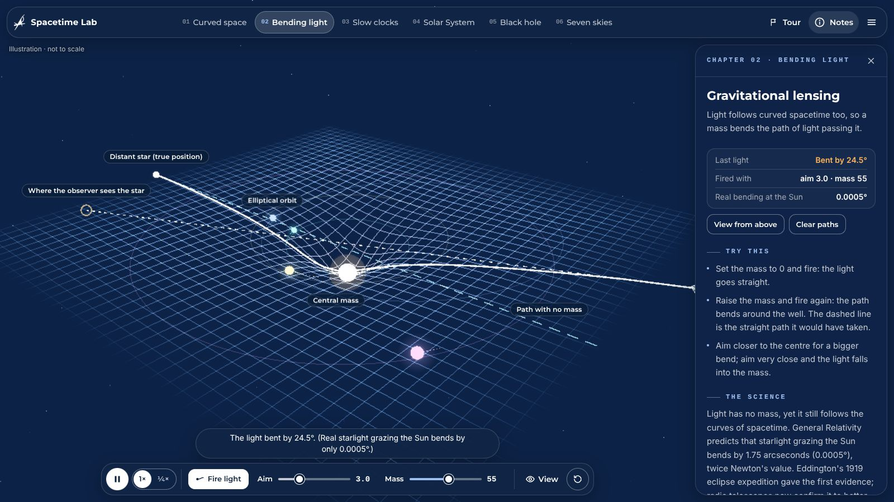
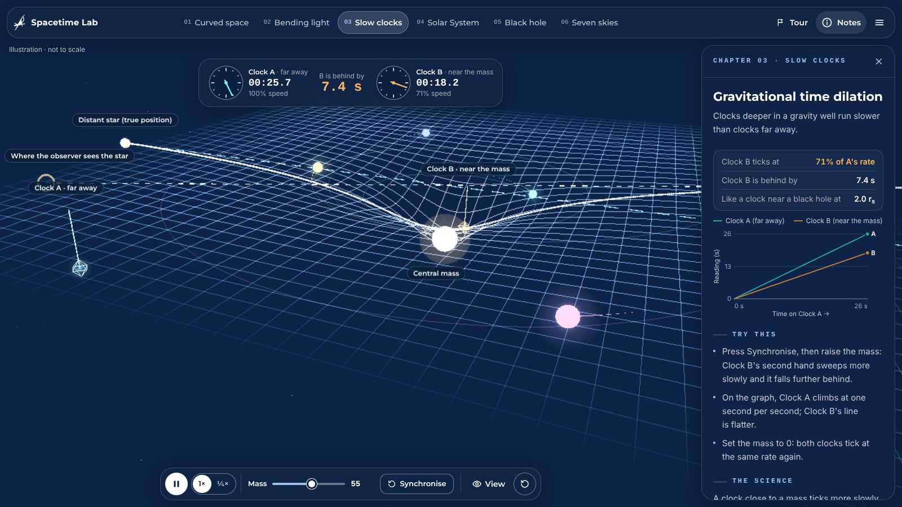
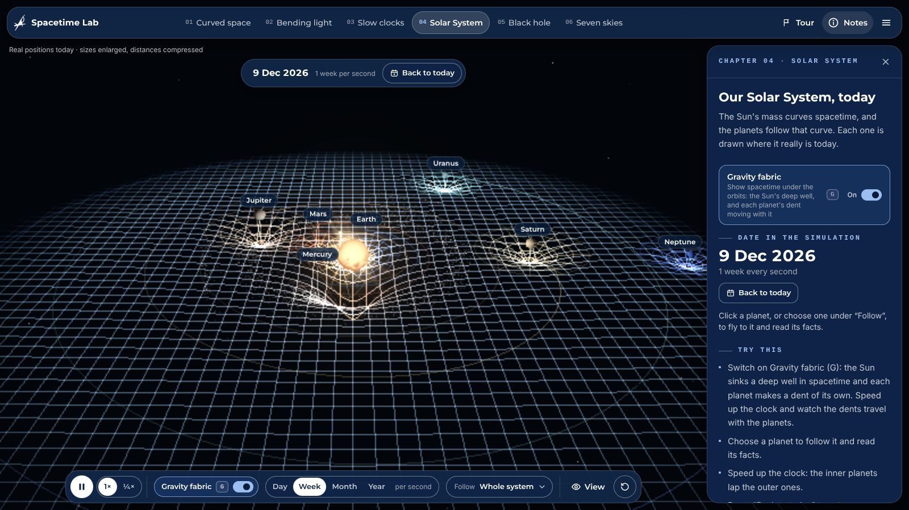
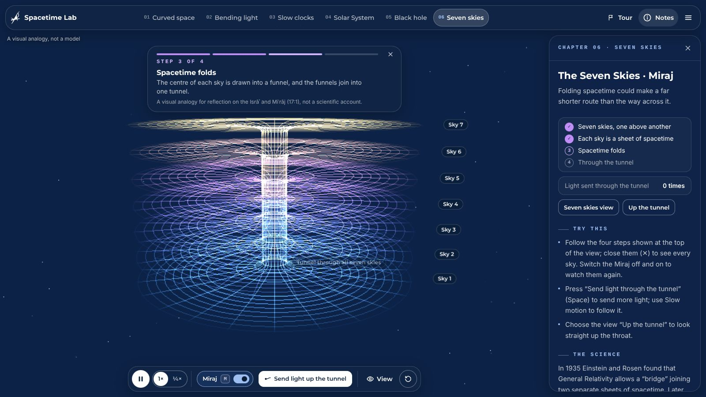

<div align="center">


# Spacetime Lab

**An interactive 3D journey through gravity: how mass bends space, light and time.**

*Built by Team LPPS for Azeemi Gala*

🏆 **4th place out of 265 teams**




</div>

---

## About the project

**Spacetime Lab** is a browser-based teaching tool that makes Einstein's General Relativity something you can see and play with. It starts from a single idea, *mass curves spacetime*, and builds on it chapter by chapter: from a bending grid, to light that curves around a mass, to clocks that tick slower in a gravity well, to our real Solar System as it stands today, and finally to a black hole drawn with physically accurate light bending.

Alongside the science, the lab presents two Quranic themes for reflection: *yasbaḥūn* ("each, in an orbit, is swimming", 36:40) beside the orbits of curved space, and the *Miraj* (the ascent through the Seven Skies) as a visual analogy inspired by the Einstein–Rosen bridge. The verses are shown as themes for reflection, not as proof, and the science is not presented as proof of scripture.

The lab was designed to be presented live, on an ordinary school laptop and a projector, to an audience with no physics background. That shaped every decision: it runs smoothly **without a graphics card**, has a four-minute **guided tour** driven by a presentation clicker, a **presenter/TV mode** that mirrors one window onto a second screen, and meets **WCAG 2.2 AA** accessibility guidelines.

### 🏆 Achievement

Spacetime Lab was Team LPPS's entry at **Azeemi Gala**, where it **secured 4th position out of 265 competing teams**.

## Highlights

- **Six interactive chapters**, each built around one idea, with live readouts, "try this" prompts, the science behind it and a key to the picture.
- **Real physics where it counts**: Keplerian orbits, the Schwarzschild time-dilation rate, true null geodesics around a black hole, and planet positions computed from NASA JPL orbital elements for *today's* date.
- **A physically based black hole**: shadow, photon ring and a thin accretion disk with Doppler beaming and gravitational redshift, rendered in a single full-screen shader pass.
- **Runs anywhere**: automatic Full / Light / Minimal graphics levels, adaptive resolution, and a steady 30 fps even with software rendering only.
- **Made for the stage**: guided tour, clicker support (Page Up / Page Down), and a two-window presenter mode for a laptop plus a TV or projector.
- **Accessible**: keyboard control of the whole lab including the 3D view, screen-reader announcements, reduced-motion support, adjustable text size and 7:1 text contrast.

## Screenshots

| | |
|---|---|
|  |  |
| **01 · Curved space**: mass bends the grid; bodies orbit along the curve. | **02 · Bending light**: gravitational lensing, with the true and apparent star. |
|  |  |
| **03 · Slow clocks**: gravitational time dilation, live. | **04 · Solar System**: the planets where they are today, with the gravity fabric on. |
|  |  |
| **05 · Black hole**: real light bending and three clocks. | **06 · Seven skies**: the Miraj, a visual analogy for reflection. |

## Getting started

**Requirements:** [Node.js](https://nodejs.org/) 20.9 or newer, and a browser with WebGL 2 (any recent Chrome, Edge or Firefox).

```bash
git clone https://github.com/lpps-1/Gravitational-Field.git
cd Gravitational-Field
npm install
npm run exhibit    # builds, then serves http://localhost:3000
```

Use `npm run exhibit` (the production build) for any presentation or exhibition; it is much smoother than development mode. For development, run `npm run dev`. `npm run lint` type-checks the project.

| Script | What it does |
|---|---|
| `npm run dev` | Development server with hot reload |
| `npm run build` | Production build |
| `npm run start` | Serve an existing production build |
| `npm run exhibit` | Build, then serve on port 3000 |
| `npm run lint` | Type-check with `tsc --noEmit` |

## The six chapters

Choose a chapter in the navigation bar (or press `1` to `6`). Each chapter's controls sit in the dock at the bottom of the 3D view; its notes (live readouts, things to try, the science, the verse and a key to the picture) are in the panel on the right, which `H` hides.

| | Chapter | What you see | What it teaches |
|---|---|---|---|
| **01** | Curved space | A wireframe fabric that sinks into a gravity well as you raise the **Mass**. Four bodies ride the fabric in Keplerian orbits, with faint outlines of each whole orbit. Set the mass to 0 and they fly off in straight lines. | Mass curves spacetime; an orbit is free motion along that curve. *"…each, in an orbit, is swimming"* (36:40; 21:33). |
| **02** | Bending light | **Fire light** sends light from a distant star across the grid, aimed at a chosen distance from the centre. With no mass it goes straight; with mass it bends, or falls in. When it arrives, the lensing diagram appears: the true star, the observer, and where the observer sees the star. | Light follows curved spacetime (GR's factor of 2 over Newton; Eddington, 1919). |
| **03** | Slow clocks | Two analog clocks side by side, plus a live graph. Clock A is far away; Clock B sits deep in the well, and its second hand visibly sweeps slower. | Clocks deeper in a gravity well run slower: dτ/dt = √(1 − rₛ/r). (22:47 is shown for reflection.) |
| **04** | Solar System | The Sun and the eight planets **where they are today**, from NASA JPL orbital elements, with real tilts, spins, Saturn's rings, the Moon at its real phase and the asteroid belt. Run the clock at a day, week, month or year per second; click a planet (or choose it under **Follow**) to fly to it and read its facts. Switch on **Gravity fabric** (`G`) to lay chapter 01's grid under the orbits: the Sun sinks a deep well and each planet makes a dent that travels with it. | The Sun's mass keeps the planets on their orbits; Mercury's 43″ per century; a clock on the Sun's surface loses about 67 s a year, on Earth's surface about 0.02 s. (21:33 is shown for reflection.) |
| **05** | Black hole | A black hole drawn with **real light bending**: its shadow, the photon ring, and a hot accretion disk whose far side is bent into view above and below the hole, brighter on the side turning towards us. Three clocks run side by side: deep space, the Sun's surface, and yours, which you move towards the horizon. | Gravitational time dilation from the Sun to a black hole: at 1.5 horizon radii, 1 hour on your clock is 1 hour 44 minutes in deep space. (70:4 is shown for reflection.) |
| **06** | Seven skies | The **Miraj**: seven stacked skies lift, then fold their centres into one tunnel, and light rises through all seven in a fraction of a second. Captions explain the four steps. | A visual analogy, inspired by the Einstein–Rosen bridge, for reflection on the Isrāʾ and Miʿrāj (17:1, 67:3). Not a scientific account. |

A **guided tour** (14 steps, about four minutes) introduces each idea in turn, and works with a presentation clicker (Page Down / Page Up).

## Controls

| Input | Action |
|---|---|
| Drag · right-drag · scroll/pinch | Rotate 360°, pan, zoom |
| `1` to `6` | Open a chapter |
| View menu (eye icon) | Camera presets for the chapter, and the Labels switch |
| `Space` | Fire light (through the tunnel during the Miraj) |
| `M` | Engage or disengage the Miraj |
| `G` | Gravity fabric on or off (Solar System) |
| `P` · `.` · `S` | Play/pause · step while paused · slow motion |
| `[` `]` · `0` `9` | Mass −5 / +5 · mass 0 / 100 |
| `R` · `L` · `H` · `T` | Synchronise clocks · labels · hide the chapter notes · start the tour |
| `?` | All keyboard shortcuts |
| `Alt+Shift+Backspace` | Reset all |
| 3D view focused: arrows, `+` `−`, `Home` | Rotate, zoom, back to the chapter's view |

Single-key shortcuts can be turned off in Settings; then use `Alt+Shift` with the same key (for example `Alt+Shift+M`).

## Presenting

### Presenter and TV (two windows)

With a TV or projector connected as a second screen (extended, not mirrored), one window can drive another:

1. On the laptop, open **http://localhost:3000/?mode=control**. A **CONTROLLING TV** badge shows in the bar; its dot lights up while a display is following.
2. Open **http://localhost:3000/?mode=display** in a second window, drag it to the TV and press **F11** for full screen.

The display mirrors the controller: the chapter, every control, the notes, the tour, dialogs, the simulation clocks and, every frame, the camera. It ignores its own mouse and keyboard and hides the pointer. Either window can be opened first; a display catches up whenever the controller is (re)loaded.

The two windows talk through the browser's BroadcastChannel, so they must be in the same browser on the same computer; nothing goes over the network. Without `?mode=`, the lab works on its own.

### Smooth on a laptop without a graphics card

The lab checks the computer when it starts and picks one of three graphics levels. You can also choose one in **Settings** (menu ☰ → Settings):

| Level | Picked for | What changes |
|---|---|---|
| **Full** | A graphics card | Bloom glow, 4× anti-aliasing, up to 1.5× resolution |
| **Light** | Built-in graphics (Intel UHD / Iris, AMD Radeon Graphics) | No post-processing pass; glow comes from cheap sprites; up to 1× resolution |
| **Minimal** | No graphics acceleration (the browser draws on the processor) | Lower resolution, no anti-aliasing, a steady 30 fps, no scanline overlay |

While it runs, the lab measures the frame rate. If a computer can't keep up, it lowers the resolution, and in Automatic mode it moves down a level.

Tips for Windows laptops:

- Use the production build (`npm run exhibit`), not `npm run dev`.
- Plug the laptop in and set **Power mode** to *Best performance*; turn the browser's Energy Saver off.
- Keep graphics acceleration on: Chrome or Edge → Settings → System → **Use graphics acceleration when available**. Check `chrome://gpu` or `edge://gpu`: *WebGL2* should read *Hardware accelerated*. If it is off, the lab still runs, in Minimal mode.

## How it works

### Tech stack

- **[Next.js 16](https://nextjs.org/)** (App Router) and **React 19**
- **[React Three Fiber](https://r3f.docs.pmnd.rs/)**, **drei** and **@react-three/postprocessing** on **Three.js**
- **[Zustand](https://zustand.docs.pmnd.rs/)** for UI and per-frame simulation state
- **Tailwind CSS 4**, Montserrat and Amiri typefaces
- Custom **GLSL** shaders for the grid, the Seven Skies, the Solar System and the black hole

### Performance

- The grid and the Seven Skies are bent on the GPU by vertex shaders; the CPU does no per-vertex work.
- Every shader is compiled while the loading screen is up, so the first photon and the first Miraj never freeze the screen.
- Photon paths and orbit trails reuse preallocated buffers, so there is no per-frame garbage.
- The graphics level is chosen before the 3D view is created, so nothing is built twice. Only the Full level runs the bloom pass (at half resolution).
- The black hole is one full-screen pass. Light paths around a Schwarzschild black hole are integrated once (about 10 ms) into a small lookup table; each pixel then follows its bent ray with a few texture reads instead of integrating it.
- The Solar System uses small custom shaders with no scene lights, sprite glows instead of post-processing, and an asteroid belt that turns on the GPU. Surface maps load in idle time, after the lab is ready.
- **Worst case measured**: software rendering only (no graphics hardware, 4-core processor, 1280×550): about 30 fps in most chapters, and 22–30 fps in the clocks and black hole chapters.

### Standards

- **WCAG 2.2 AA**: text contrast at least 7:1 on panels; text at least 12 px (Text size setting up to 150%); a visible focus ring everywhere; the 3D view and all controls work from the keyboard; results are announced to screen readers; Pause, Step and Reset all are available; reduced motion is respected.
- **Simulation conventions (PhET / ESA style)**: Play/Pause/Step, speed choice, a round Reset all button, a Labels toggle, camera presets, About, Keyboard and Settings dialogs, and an honest line about scale on every chapter.
- **Responsive layout**: fits a 1280×550 window (a 15" laptop at 150% scaling) without scrolling, as well as 1366×768, 1920×1080 and phones.

### Project layout

```
app/                     Next.js App Router (layout, page, global CSS and design tokens)
components/Lab.tsx       Screen layout
components/scene/        3D scene (React Three Fiber)
  Scene.tsx              Canvas, bloom, shader warm-up, frame cap, adaptive resolution, camera
  SimDriver.tsx          Shared time step, pause/speed, Miraj timeline, clocks
  SpacetimeGrid.tsx      01: the grid (vertex shader)
  OrbitingBodies.tsx     01: Kepler orbits, trails, straight-line release
  PhotonBeams.tsx        02: photon pool and lensing diagram
  TimeClocks.tsx         03: clock beacons
  SolarSystem.tsx        04: the Sun, planets, rings, Moon and asteroid belt
  SolarFabric.tsx        04: the gravity fabric under the orbits
  BlackHole.tsx          05: light-bending pass and the three clocks
  SevenSkies.tsx         06: seven skies (vertex shader), tunnel light
components/ui/           Navigation, dock, chapter notes, captions, dialogs, tour
lib/physics.ts           Physics of the grid, light and clocks
lib/solar.ts             Planet positions (JPL elements) and physical data
lib/blackhole.ts         Light-bending table and clock rates
lib/content.ts           All explanatory text, verses and labels
lib/tour.ts              The guided tour
lib/quality.ts           Graphics levels and the hardware check
lib/sync.ts              Presenter / TV sync (?mode=control, ?mode=display)
lib/store.ts             UI state and per-frame simulation values
```

## A note on accuracy

The physics is qualitatively faithful, but most chapters use dimensionless "simulation units" (1 grid square = 1 unit) and are not to scale:

- The well follows a softened Newtonian-potential profile. The 2-D sheet is a teaching analogy; real spacetime has no "down".
- Lensing integrates a 2·GM/r² bend. Real light grazing the Sun bends by only 0.0005°.
- Time dilation uses the Schwarzschild rate. On Earth's surface a clock loses only about 0.02 s a year to gravity.
- Orbits follow Kepler's equation.
- **Solar System**: positions come from NASA JPL's "Approximate Positions of the Planets" (E. M. Standish), good to a few arcminutes between 1800 and 2050. Distances are compressed (drawn at 9·√r, r in au) and sizes enlarged so all eight planets fit; tilts, spin periods and orbital periods are real. Clock losses quoted are the weak-field values GM/(Rc²).
- **Black hole**: light paths are true Schwarzschild null geodesics (non-spinning hole). The disk is a thin disk from 3 to 12 horizon radii with the standard thin-disk temperature profile, T ∝ r^(−3/4)·(1 − √(r_in/r))^(1/4), and the exact frequency shift of gas on circular orbits (Doppler beaming and gravitational redshift; intensity ∝ g⁴); its turbulence is procedural. Clock rates are exact for clocks hovering at rest: √(1 − rₛ/r).

Traversable wormholes remain theoretical. The Seven Skies chapter is a visual analogy for reflection, not a claim about how the Miraj happened. Verse translations: Sahih International.

## Credits

- **Planet and Sun surface maps**: [Solar System Scope](https://www.solarsystemscope.com/textures/), based on NASA imagery, [CC BY 4.0](https://creativecommons.org/licenses/by/4.0/) (resized; see `public/textures/planets/CREDITS.txt`).
- **Planet positions**: NASA JPL, "Approximate Positions of the Planets" (E. M. Standish).
- **Montserrat** typeface: The Montserrat Project Authors, SIL Open Font License 1.1 (`public/fonts/Montserrat-OFL.txt`).
- **Amiri** typeface (Arabic): SIL Open Font License 1.1, via [Fontsource](https://fontsource.org/).
- **LPPS logo**: Team LPPS.

## Team

Built by **Team LPPS** for **Azeemi Gala**, where the project placed **4th out of 265 teams**.

## Licence

© 2026 Team LPPS. The LPPS name and logo belong to Team LPPS. Third-party assets remain under their own licences, listed in [Credits](#credits).
